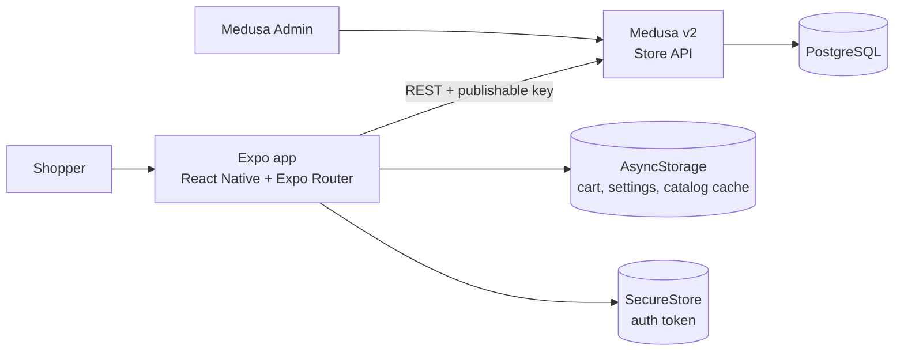
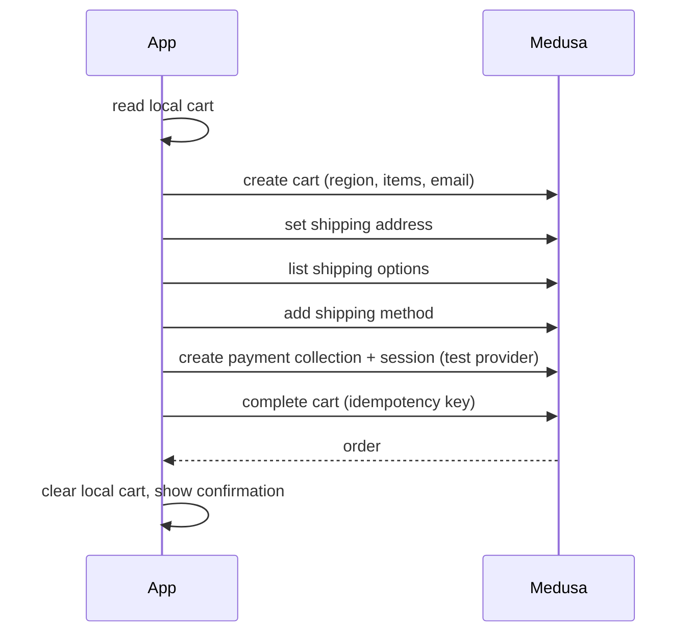

<p align="center">
  
</p>

<h1 align="center">Khafif (خفيف)</h1>

<p align="center">
  <strong>Light on data. Light on the eyes.</strong><br/>
  An Arabic-first, low-bandwidth mobile storefront built with Expo (React Native) and Medusa v2.
</p>

> **Portfolio project.** Sample catalog and test payments only. No real payments are taken, and the catalog is invented data, not real inventory or prices. This is not a production store.

---

## Why Khafif

Many shoppers use weak or expensive mobile data. Khafif is designed around that constraint:

- **Small payloads:** paginated lists (12 per page), field-restricted requests, small images.
- **Survives lost connection:** the cart lives on the device and syncs to the backend only when checkout starts. Cached catalog pages stay readable offline.
- **Arabic first:** full RTL layout with an English alternative, switchable at runtime without restarting the app.
- **Honest money handling:** the client shows labelled estimates while browsing; the final total always comes from Medusa.

## Features

| Area | What it does |
|---|---|
| Catalog | Infinite-scroll product grid, debounced search (400 ms), category filter, product detail with variants |
| Cart | Local-first cart, merge by variant, stock-based quantity limits, persisted across restarts |
| Checkout | Guest email and address with localized validation, backend shipping options, test payment, order confirmation |
| Language | Arabic and English, RTL and LTR, runtime switch |
| Connectivity | Reachability check against the backend, offline banner, persisted catalog cache |
| Quality | TypeScript strict, ESLint, Jest and React Native Testing Library, GitHub Actions workflow |

See [Project status](#project-status) for what is verified and what is not.

## Architecture



Inside the app, screens talk to feature hooks, hooks talk to `src/api` (the only module that imports the Medusa SDK), TanStack Query holds server state, and Zustand holds the cart and settings.

### Checkout sequence (online only)



Server totals are authoritative. There is deliberately **no offline order queue**: orders need confirmation, and queuing risks duplicates.

## Tech stack

| Layer | Choice |
|---|---|
| Mobile | Expo SDK 58, React Native 0.88, TypeScript (strict), Expo Router |
| Server state | TanStack Query v5 with a persisted cache (catalog keys only) |
| Client state | Zustand with `persist` |
| Backend | Medusa 2.22.1 on PostgreSQL 16, official `@medusajs/js-sdk` |
| i18n | i18next, react-i18next, expo-localization |
| UI | StyleSheet with design tokens, IBM Plex Sans Arabic, `expo-image` |
| Tests | Jest, jest-expo, React Native Testing Library |
| Tooling | ESLint (`eslint-config-expo`), Prettier, GitHub Actions |

Exact installed versions and the justification for every extra dependency are in [`docs/VERSIONS.md`](docs/VERSIONS.md). Every decision with its rejected alternatives is in [`docs/02-TECH-STACK-AND-DECISIONS.md`](docs/02-TECH-STACK-AND-DECISIONS.md) and [`docs/13-DECISIONS-ADDENDUM.md`](docs/13-DECISIONS-ADDENDUM.md).

## Repository layout

```
khafif/
  assets/          logo and brand assets
  docs/            architecture, API contract, design system, testing, security, status
  infra/           docker-compose.yml (PostgreSQL)
  apps/backend/    Medusa v2 (seed script, config)
  apps/mobile/     Expo app (routes in src/app, code in src/)
```

`apps/backend` and `apps/mobile` are independent npm projects (no monorepo tooling).

## Getting started (Windows)

**Prerequisites:** Node.js 22.23.4 or newer, Git, Docker Desktop, and the **Expo Go** app on your phone (same Wi-Fi as the computer).

**1. Database**

```powershell
docker compose -f infra/docker-compose.yml up -d
```

**2. Backend**

```powershell
cd apps/backend
copy .env.example .env
```

Fill `.env`: generate `JWT_SECRET` and `COOKIE_SECRET` with
`node -e "console.log(require('crypto').randomBytes(32).toString('hex'))"`, and set `BACKEND_URL=http://<your-LAN-IP>:9000` **before seeding** (image URLs are stored absolute). Then:

```powershell
npm install
npx medusa db:migrate
npx medusa user -e admin@example.test -p "<choose-a-password>"
npm run seed        # prints the publishable key (pk_...)
npm run dev         # Admin at http://localhost:9000/app
```

**3. Mobile app**

```powershell
cd apps/mobile
copy .env.example .env
```

```
EXPO_PUBLIC_MEDUSA_URL=http://<your-LAN-IP>:9000
EXPO_PUBLIC_MEDUSA_PUBLISHABLE_KEY=<pk_... printed by the seed>
```

```powershell
npm install
npx expo start      # scan the QR code with Expo Go
```

A phone cannot use `localhost`: always use the computer's LAN IPv4. Android emulator: `http://10.0.2.2:9000`. If the phone cannot connect, allow Node through Windows Firewall for ports 9000 and 8081.

## Scripts

| Where | Command | Purpose |
|---|---|---|
| `apps/mobile` | `npx expo start` | Dev server |
| `apps/mobile` | `npm run typecheck` | `tsc --noEmit` |
| `apps/mobile` | `npm run lint` | ESLint via Expo |
| `apps/mobile` | `npm test` | Jest + React Native Testing Library |
| `apps/backend` | `npm run dev` | Medusa dev server |
| `apps/backend` | `npm run seed` | Idempotent sample data (ILS, 4 categories, 16 products) |
| `apps/backend` | `npm run build` | Backend build |

## Offline and performance design

| Situation | Behavior |
|---|---|
| Offline with cached catalog | Cached lists and details shown, offline banner visible |
| Offline without cache | Empty state with retry, never a blank screen |
| Cart edits offline | Allowed, stored locally |
| Checkout offline | Disabled with an explanation |
| Back online | Queries resume, banner dismisses |

Targets (not yet measured): list requests limited to 12 items with only the fields a card renders, images of roughly 100 KB or less at fixed display size, search debounced and cancelled on new input. Measured numbers will go to `docs/PERFORMANCE.md`; until then none are claimed.

## Security notes

- Only `EXPO_PUBLIC_*` values (backend URL and the publishable key) reach the app bundle. Real secrets stay in `.env` files that are never committed.
- Auth tokens use `expo-secure-store`, never AsyncStorage.
- Payments use Medusa's default test provider. No card data touches the system.
- This is a baseline for a portfolio app, not a security audit. Rate limiting and WAF would belong to the hosting layer in a real deployment.

## Project status

| Milestone | State |
|---|---|
| M0 Setup | Done |
| M1 Backend data and seed | Done, verified (end-to-end order created against a live backend in a sandbox) |
| M2 App shell (i18n, RTL, tabs, offline banner) | Done, checks passing |
| M3 Catalog | Implemented, not yet verified against a live backend |
| M4 Cart | Implemented, logic tests passing, device behavior not verified |
| M5 Checkout | Implemented, SDK usage checked against Medusa 2.22.1 types, live run not verified |
| M6 Tests and CI | Type check and lint passing; CI workflow written but not yet run on GitHub |
| M7 Wishlist (custom Medusa module) | Not started (optional) |

Detailed evidence, gaps and the re-verification checklist: [`docs/STATUS.md`](docs/STATUS.md).

## Known limitations

- No testing on a physical phone has been recorded yet.
- No server-side image resizing or CDN; cache invalidation is time-based.
- Cart price estimates can drift from server prices until checkout.
- The runtime RTL switch uses a layout-direction approach compatible with Expo Go (see ADR-7), and still needs a device check.
- Shipping options that need a calculated price are not selectable.
- Guest checkout only.

## Documentation

| Topic | File |
|---|---|
| Scope and success criteria | [`docs/00-PROJECT-BRIEF.md`](docs/00-PROJECT-BRIEF.md) |
| Architecture | [`docs/01-ARCHITECTURE.md`](docs/01-ARCHITECTURE.md) |
| Tech stack and decisions | [`docs/02-TECH-STACK-AND-DECISIONS.md`](docs/02-TECH-STACK-AND-DECISIONS.md) |
| Data model | [`docs/03-DATABASE-SCHEMA.md`](docs/03-DATABASE-SCHEMA.md) |
| API contract | [`docs/04-API-CONTRACT.md`](docs/04-API-CONTRACT.md) |
| Design system and brand | [`docs/05-DESIGN-SYSTEM.md`](docs/05-DESIGN-SYSTEM.md) |
| Screens | [`docs/06-UI-SCREENS.md`](docs/06-UI-SCREENS.md) |
| Offline and performance | [`docs/07-OFFLINE-AND-PERFORMANCE.md`](docs/07-OFFLINE-AND-PERFORMANCE.md) |
| Security | [`docs/08-SECURITY.md`](docs/08-SECURITY.md) |
| Testing strategy | [`docs/09-TESTING-STRATEGY.md`](docs/09-TESTING-STRATEGY.md) |
| Windows setup | [`docs/10-SETUP-WINDOWS.md`](docs/10-SETUP-WINDOWS.md) |
| Roadmap | [`docs/11-ROADMAP-AND-AGENT-PROMPTS.md`](docs/11-ROADMAP-AND-AGENT-PROMPTS.md) |
| Decisions made during implementation | [`docs/13-DECISIONS-ADDENDUM.md`](docs/13-DECISIONS-ADDENDUM.md) |
| Current status and evidence | [`docs/STATUS.md`](docs/STATUS.md) |

## About

Khafif is a lightweight, Arabic-first e-commerce application designed for users who rely on limited or expensive mobile data.

The project focuses on performance, accessibility, reliable shopping experiences, and practical offline support. It combines a React Native mobile application with a Medusa commerce backend, using a modular architecture and automated testing to support maintainability and future development.

Khafif is a portfolio project featuring a sample product catalog and a test-only checkout flow. It is not a production store, and no real payments are processed.

**License:** Not yet specified.