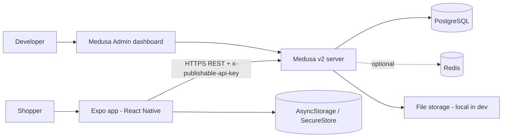
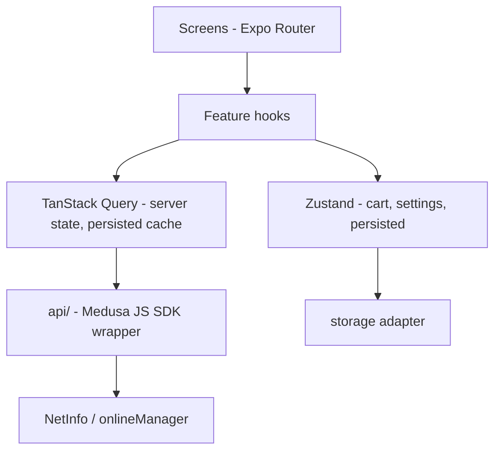
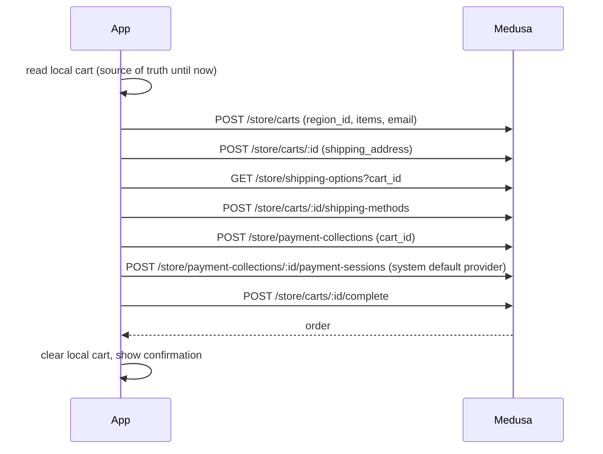
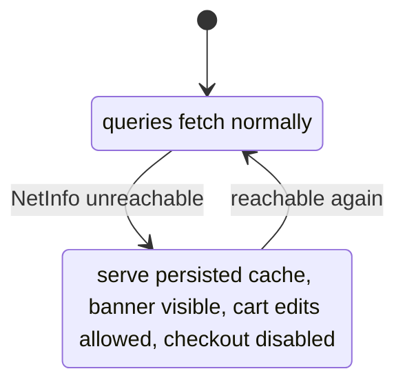

# 01 — System Architecture

## 1. Context


## 2. Mobile app layers

Rules: screens never call the SDK directly; features talk to `src/api`; only `src/api` imports `@medusajs/js-sdk`. Components under `src/ui` have no business logic.

## 3. Folder structure
```
apps/mobile/
  app/                      Expo Router routes
    _layout.tsx             providers, fonts, i18n, query client
    (tabs)/_layout.tsx  index.tsx  cart.tsx  account.tsx
    product/[id].tsx   checkout/index.tsx   order/[id].tsx
  src/
    api/        sdk.ts  products.ts  cart.ts  checkout.ts  wishlist.ts  errors.ts
    features/   catalog/  cart/  checkout/  settings/  wishlist/
    ui/         Button  TextField  Chip  ProductCard  QuantityStepper  Banner  PriceText  EmptyState  Skeleton
    i18n/       index.ts  ar.json  en.json
    theme/      tokens.ts  useTheme.ts
    lib/        money.ts  network.ts  storage.ts  rtl.ts
  __tests__/ or *.test.tsx beside source
apps/backend/
  src/modules/wishlist/     models/ service.ts index.ts migrations/
  src/api/store/wishlist/   route.ts  [item_id]/route.ts  middlewares.ts
  src/links/                (only if using module links)
  src/scripts/seed.ts
  integration-tests/http/
```

## 4. Checkout sequence (online only)

Server prices are authoritative. If totals differ from the local estimate, show the server total and a "prices updated" notice before completing.

## 5. Connectivity model

Use `onlineManager` (TanStack Query) wired to NetInfo. "Connected" means the Medusa host is reachable, not just that Wi-Fi is on.

## 6. Error handling
`src/api/errors.ts` maps SDK/HTTP errors to a small union: `Offline | Timeout | NotFound | Validation | Server | Unknown`. UI shows a localized message plus a retry action. Never show raw server text to users. Log (dev only) without PII.

## 7. Configuration
| Variable | Where | Public? |
|---|---|---|
| `EXPO_PUBLIC_MEDUSA_URL` | mobile `.env` | yes (URL only) |
| `EXPO_PUBLIC_MEDUSA_PUBLISHABLE_KEY` | mobile `.env` | yes (publishable by design) |
| `DATABASE_URL`, `JWT_SECRET`, `COOKIE_SECRET`, `STORE_CORS`, `ADMIN_CORS`, `AUTH_CORS` | backend `.env` | **never committed** |

On a physical phone, `EXPO_PUBLIC_MEDUSA_URL` must be the computer's LAN IP (e.g. `http://192.168.x.x:9000`), not `localhost`. Android emulator uses `http://10.0.2.2:9000`. Cleartext HTTP is for local development only.
