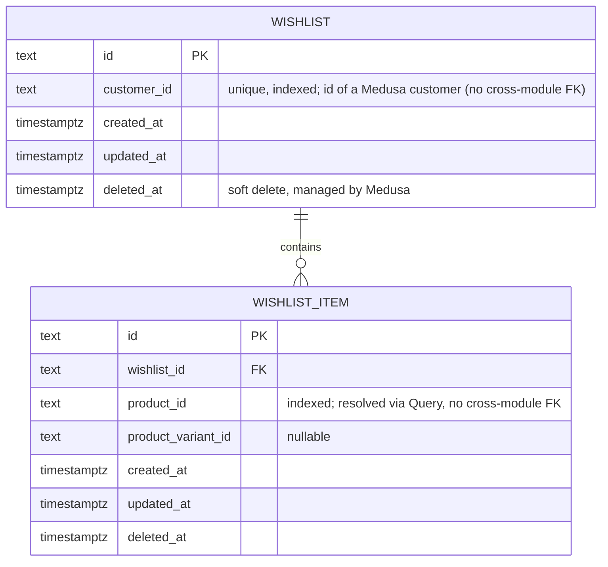

# 03 — Database Schema

The database is PostgreSQL owned by **Medusa v2**. Do **not** recreate or edit Medusa's core tables. This document has three parts: (A) core entities the app reads/writes through the Store API, (B) our custom module tables, (C) client-side persisted state.

## A. Medusa core entities used (managed by Medusa; reference only)
Product (title, thumbnail, images, handle), ProductVariant (title, options, sku, inventory), ProductOption/Value, ProductCategory, Price/PriceSet (calculated per region/currency), Region (currency, countries), SalesChannel, PublishableApiKey (scopes requests to a sales channel), Cart + LineItem, ShippingOption, PaymentCollection + PaymentSession, Customer, Order.
Seed: one region (currency chosen by the owner, e.g. ILS), one sales channel linked to the publishable key, one stock location with inventory, 12–20 small sample products with 1–3 variants, 3–4 categories.

## B. Custom module: `wishlist` (stretch milestone)

Constraints: unique(`customer_id`) on wishlist; unique(`wishlist_id`, `product_id`) on item (partial index on non-deleted rows if the docs show how); index on `wishlist_item.product_id`.
Rules: define models with Medusa's DML (`model.define`), generate migrations with `npx medusa db:generate wishlist`, apply with `npx medusa db:migrate`. Modules are isolated: reference other modules by **ID only**, or use Module Links as shown in Medusa docs. Follow the official wishlist guide for exact syntax.
Authorization: every wishlist route is customer-authenticated; a customer may only read/modify their own wishlist (derive `customer_id` from the auth context, never from the request body).

## C. Client persisted state (AsyncStorage)
| Key | Shape | Notes |
|---|---|---|
| `khafif.cart.v1` | `{ version: 1, regionId, items: [{ variantId, productId, title, thumbnail, unitAmount, currencyCode, quantity, addedAt }], updatedAt }` | Zustand persist; `unitAmount` is a display estimate; migrate on `version` change |
| `khafif.settings.v1` | `{ version: 1, locale: "ar"|"en", lastSeenOnboarding?: boolean }` | locale default from `expo-localization`, fallback `ar` |
| `khafif.rq.v1` | TanStack Query dehydrated cache (catalog + categories only) | `maxAge` 24 h, `buster` = app version |
| SecureStore `medusa_auth_token` | JWT | Only when a customer logs in |

Never persist: payment data, full addresses after order completion, passwords.
